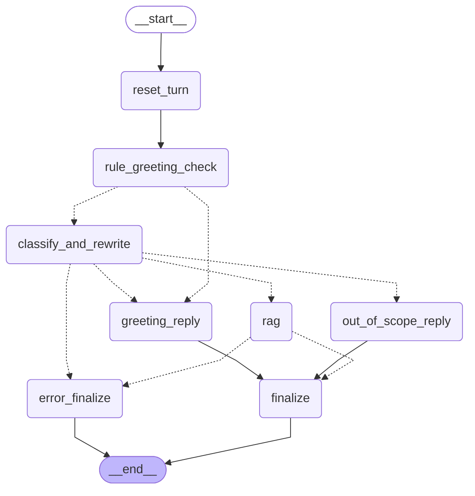
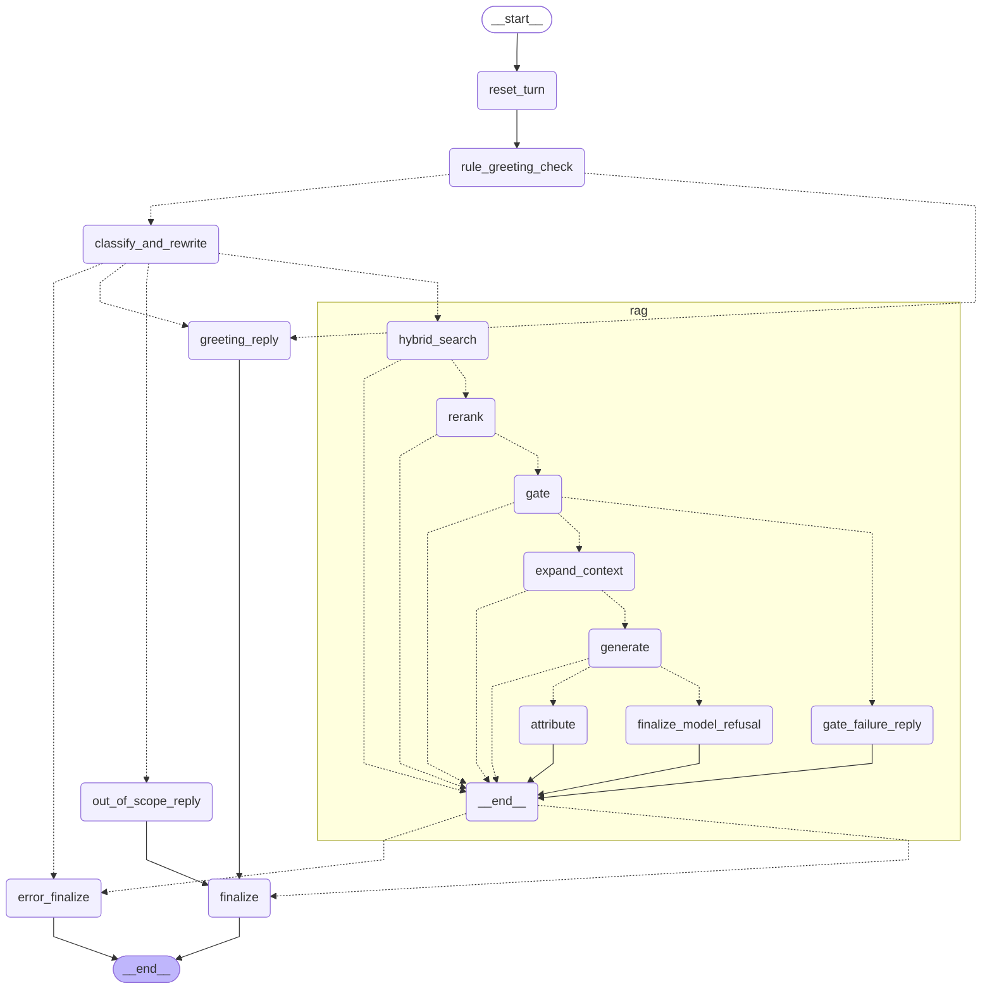

# NIST AI RMF Assistant

An agentic retrieval-augmented question-answering system over two NIST documents: **AI RMF 1.0 (NIST AI 100-1)** and the **Generative AI Profile (NIST AI 600-1)**. Ask a question (and follow-ups) over HTTP and get a short, grounded answer with citations that open the exact PDF page, or an honest "the documents do not contain this" when they do not. It is built with **LangGraph** behind a **FastAPI** API, uses **Groq's free tier** as the LLM, `bge-small-en-v1.5` embeddings in **Chroma**, a **BM25** keyword index, and a `bge-reranker-base` cross-encoder. The reasoning behind each choice is in [`DESIGN.md`](DESIGN.md).

## Quickstart

```bash
git clone <repository-url> nist-rag && cd nist-rag
python3.12 -m venv .venv && source .venv/bin/activate     # Windows: .venv\Scripts\activate
make install                                               # pip install -r requirements.txt
cp .env.example .env                                       # then put your Groq API key in GROQ_API_KEY=
make build                                                 # download the PDFs, then ingest -> chunk -> index
make serve                                                 # start the API (leave it running)
```

In a second terminal:

```bash
make ask Q="What are the four core functions of the NIST AI RMF?"
```

<!-- TIMINGS:START -->
Timings for each step are added after the fresh-clone acceptance test.
<!-- TIMINGS:END -->

No `make`? Section 6 pairs every target with its Python command.

## Requirements

- **Python 3.12** (the version this project was built and tested with) and `pip`.
- **Internet, once:** the two NIST PDFs (downloaded by `make build`), the Hugging Face models (`bge-small-en-v1.5`, `bge-reranker-base`, downloaded on first use), and, at run time, the Groq API.
- **A Groq API key** (free tier): <https://console.groq.com>.
- **Disk and memory:** PyTorch and the two Hugging Face models are the large downloads. Everything runs on CPU; Apple-silicon and CUDA GPUs are used automatically when available.
- **Optional:** [Tesseract](https://github.com/tesseract-ocr/tesseract) for figure OCR (see below).
- Developed on macOS; Linux works the same way. On Windows use the Python commands in section 6.

## Installation

```bash
python3.12 -m venv .venv
source .venv/bin/activate            # Windows: .venv\Scripts\activate
pip install -r requirements.txt      # exact pinned versions; make install does the same
```

`requirements.txt` pins every direct dependency, and `pip check` is clean. PyTorch is the largest download.

**Optional: Tesseract (figure OCR).** Without it everything still runs: figure records keep their captions but have no OCR text, and the ingestion report lists a warning. With it, the AI RMF's figures are OCR'd and become searchable chunks.

| OS | Install |
|---|---|
| macOS | `brew install tesseract` |
| Ubuntu / Debian | `sudo apt install tesseract-ocr` |
| Windows | installer from <https://github.com/UB-Mannheim/tesseract/wiki>, then add it to `PATH` |

## Configuration

Copy `.env.example` to `.env`. Only `GROQ_API_KEY` is required; everything else has a default. `.env` is git-ignored: never commit it.

| Variable | Default | Meaning |
|---|---|---|
| `GROQ_API_KEY` | none (**required**) | Groq API key |
| `ROUTER_MODEL` | `openai/gpt-oss-120b` | Model for the routing call (route + standalone query) |
| `ROUTER_REASONING_EFFORT` | `low` | Reasoning effort of the routing call |
| `GEN_MODEL` | `openai/gpt-oss-20b` | Model that writes the answer |
| `HISTORY_TURNS` | `2` | Previous turns the router sees |
| `APP_HOST`, `APP_PORT` | `127.0.0.1`, `8000` | Where `make serve` listens |
| `MAX_MESSAGE_CHARS` | `2000` | Longer messages are rejected with a 422 |
| `LLM_MAX_ATTEMPTS`, `LLM_BASE_DELAY`, `LLM_MAX_DELAY`, `LLM_TIMEOUT` | `4`, `1.0`, `20.0`, `30.0` | Retry and timeout settings for rate-limit or temporary Groq errors |
| `RETRIEVAL_DEVICE`, `INDEX_DEVICE` | `auto` | `auto`, `cpu`, `mps` or `cuda` for the reranker and for embedding |
| `INDEX_BATCH_SIZE`, `INDEX_COLLECTION` | `32`, `nist_ai_rmf` | Embedding batch size, Chroma collection name |
| `OCR_CONFIDENCE_THRESHOLD` | `60` | Figure OCR below this confidence is dropped (`none` keeps everything) |
| `DATA_DIR`, `RAW_DIR`, `PROCESSED_DIR`, `STAGES_DIR`, `CHUNKS_PATH`, `INDEX_DIR`, `INDEX_CHROMA_DIR` | under `data/` | Where the PDFs, pipeline outputs and indexes live |
| `LANGSMITH_TRACING`, `LANGSMITH_API_KEY`, `LANGSMITH_PROJECT` | empty (**off**) | Optional LangSmith tracing. **When on, every prompt, every retrieved NIST passage and every answer is sent to LangSmith's servers.** |

## Downloading and processing the documents

```bash
make build        # ingest -> chunk -> index; stops at the first failure
```

1. **`make ingest`** downloads the two PDFs into `data/raw/` (and checks the `%PDF` header, page count, title and a pinned SHA-256), extracts every page with PyMuPDF, classifies pages, OCRs figures, cleans the text, finds the section structure and links, and validates the result (a set of hard checks; the run fails if one fails). Output: `data/processed/pages.jsonl` and `ingest_report.json`.
2. **`make chunk`** splits pages into section-aware, table-aware chunks with exact pages and citation links, then validates them. Output: `data/processed/chunks.jsonl` and `chunk_report.json`.
3. **`make index`** embeds the chunks into a Chroma collection, builds the BM25 index, validates both against the chunk IDs, and runs a small retrieval smoke test. Output: `data/chroma/` and `data/index/`.

Everything under `data/` is regenerated and git-ignored.

- **Offline PDFs:** `make ingest FROM_DIR=/path/to/pdfs` (files are found by the `100-1` / `600-1` part of the name) instead of downloading.
- **Rebuild from scratch:** `make rebuild` (deletes cached stage outputs and both indexes; keeps the PDFs). `make clean` removes `data/processed`, `data/chroma` and `data/index`; `make clean-all` also removes the PDFs after asking.
- Per-stage details of the pipeline are in [`docs/process/phase_notes.md`](docs/process/phase_notes.md); the measured size of each stage's output is in [`docs/RESULTS.md`](docs/RESULTS.md#corpus-chunks-and-indexes).

## Make targets and their Python commands

Every `make` target prints the Python command it runs. Without `make` (for example on Windows) run these in the activated virtual environment:

| Target | Python command |
|---|---|
| `make install` | `python -m pip install -r requirements.txt` |
| `make download` | `python -m ingest --only-stage 2` |
| `make ingest` | `python -m ingest` (`--from-dir <dir>` for local PDFs) |
| `make chunk` | `python -m chunking` |
| `make index` | `python -m indexing` |
| `make build` | the three commands above, in order |
| `make rebuild` | `python -m ingest --rebuild`, then `python -m chunking --rebuild`, then `python -m indexing --rebuild` |
| `make serve` | `python -m app.main` (same as `uvicorn app.main:app --host 127.0.0.1 --port 8000`) |
| `make health` | `curl http://127.0.0.1:8000/health` |
| `make ask Q="..."` | `curl -X POST http://127.0.0.1:8000/chat -H "Content-Type: application/json" -d '{"message": "...", "debug": true}'` |
| `make test` | `python -m pytest -q` |
| `make eval-routing` | `python -m eval.routing` (real Groq calls) |
| `make eval-retrieval` | `python -m eval.retrieval_eval` (local models, no LLM) |
| `make e2e` | `python -m eval.e2e --base-url http://127.0.0.1:8000` (needs a running server) |
| `make e2e-report RUN=<dir>` | `python -m eval.e2e_report --from-run <dir>` |
| `make results` | `python docs/build_results.py` |
| `make clean` | delete `data/processed`, `data/chroma`, `data/index` |

## Running the application

```bash
make serve        # loads the models once, then listens on 127.0.0.1:8000
```

| Endpoint | Purpose |
|---|---|
| `POST /chat` | One JSON response per message |
| `POST /chat/stream` | The same, as Server-Sent Events |
| `GET /health` | Is the server up, which router model, is a key configured |
| `GET /threads/{thread_id}` | The stored history of a conversation (final answer text only) |
| `DELETE /threads/{thread_id}` | Forget a conversation |

**Request** (`/chat` and `/chat/stream`): `{"message": "...", "thread_id": "...", "debug": false}`. Only `message` is required. Leave `thread_id` out to start a conversation; the response contains the id the server created, and you send it back with the next message. `debug: true` adds ids, scores, labels, timings, usage and the `key_map` (never chunk text, prompt text or reasoning).

**Response** (`/chat`):

| Field | Meaning |
|---|---|
| `thread_id` | The conversation id |
| `route` | `greeting`, `nist_question` or `out_of_scope` |
| `answer` | Plain text with `[C1]`-style citation markers |
| `sources` | Only the cited chunks: `{keys, label, url, kind}` with the label like `NIST AI 100-1, §5.1 Govern, pp. 21–22` and a `#page=N` link into the PDF; `kind` is `prose`, `table`, `figure-ocr` or `footnote` |
| `standalone_query` | The self-contained question the router made from your message and the history |
| `related_sections` | When the documents do not contain the answer: the five closest sections (never mixed into `sources`) |
| `meta` | `outcome` (`answered`, `insufficient`, `greeting`, `out_of_scope`), `insufficient_reason`, `llm_calls`, `latency_ms`, `usage` (tokens), model, prompt version, any fixes or warnings, and `debug` when requested |

**Streaming events:** `meta` → `token`… → `correction` (only if validation changed the text) → `sources` → `related` (insufficient answers only) → `done`, or `error` (nothing follows it). Only answer tokens are streamed; routing output, reasoning and chunk text never are.

**Errors** carry a code and a generic message, never a stack trace: `422` invalid or too long, `404 thread_not_found` (unknown or expired `thread_id`, for example after a restart), `409 thread_busy` (two requests at once on one conversation), `503 llm_unavailable` (rate limit or provider outage, with `Retry-After`), `500` for other failures.

## Example questions

The examples below come from the end-to-end case file [`eval/e2e_cases.yaml`](eval/e2e_cases.yaml), starting with the assignment's own. Start the server first (`make serve`).

**1. The assignment's example question**

```bash
curl -s -X POST http://127.0.0.1:8000/chat -H 'Content-Type: application/json' \
  -d '{"message": "What are the four core functions of the NIST AI RMF?"}'
```

A real answer from the end-to-end run (abridged):

```json
{
  "route": "nist_question",
  "answer": "The four core functions of the NIST AI RMF are **GOVERN, MAP, MEASURE,** and **MANAGE** [C1][C2].",
  "sources": [
    {"keys": ["C2"], "label": "NIST AI 100-1, Executive Summary, p. 3", "url": "https://nvlpubs.nist.gov/nistpubs/ai/NIST.AI.100-1.pdf#page=8", "kind": "prose"},
    {"keys": ["C1"], "label": "NIST AI 100-1, §5 AI RMF Core, pp. 20–21", "url": "https://nvlpubs.nist.gov/nistpubs/ai/NIST.AI.100-1.pdf#page=25", "kind": "prose"}
  ]
}
```

The label shows the printed page numbers; the link opens the PDF page. (Answers can contain Markdown bold such as `**GOVERN**`; see Known limitations.)

**2. A follow-up conversation (the assignment's example, three turns on one `thread_id`)**

```bash
URL=http://127.0.0.1:8000/chat
ask() { curl -s -X POST $URL -H 'Content-Type: application/json' -d "$1"; }

R1=$(ask '{"message": "What are the four functions of the AI RMF?"}'); echo "$R1"
TID=$(echo "$R1" | python3 -c 'import sys,json; print(json.load(sys.stdin)["thread_id"])')

ask "{\"message\": \"Which one is cross-cutting?\", \"thread_id\": \"$TID\", \"debug\": true}"
ask "{\"message\": \"What categories does it include?\", \"thread_id\": \"$TID\"}"
```

For the second message the router rewrites the question using the history (`standalone_query`, for example *"Which of the four AI RMF core functions is cross-cutting?"*); the answer cites the AI RMF Core and GOVERN sections.

**3. A streaming call**

```bash
curl -sN -X POST http://127.0.0.1:8000/chat/stream -H 'Content-Type: application/json' \
  -d '{"message": "What does the Generative AI Profile suggest for decommissioning GAI systems?"}'
```

**4. The documents do not contain the answer**

```bash
curl -s -X POST http://127.0.0.1:8000/chat -H 'Content-Type: application/json' \
  -d '{"message": "What are the four functions of the AI RMF, and how much does an AI RMF certification cost?"}'
```

The question is only partly answerable, so the reply is the exact sentence `The NIST documents provided do not contain this information.`, `sources` is empty, `meta.insufficient_reason` says why (here `model_case_d`), and `related_sections` lists the five closest sections (for example *NIST AI 100-1, §5 AI RMF Core, pp. 20–21*).

**5. Out of scope, and a greeting**

```bash
curl -s -X POST http://127.0.0.1:8000/chat -H 'Content-Type: application/json' -d '{"message": "What is the capital of France?"}'
curl -s -X POST http://127.0.0.1:8000/chat -H 'Content-Type: application/json' -d '{"message": "Hello!"}'
```

The first returns `Sorry, we don't have this answer.` after one LLM call; the second returns the greeting text without any LLM call.

More questions to try: *What characteristics make an AI system trustworthy according to the AI RMF?*, *What is suggested action GV-1.7-001?* (an exact-ID lookup), *What is confabulation in the Generative AI Profile?*. `./testing_curl.sh` runs a set of curl tests against a running server (`./testing_curl.sh` lists them).

## How it works

A message enters the main graph, which routes it; questions about the documents go through the RAG subgraph (retrieve, then answer). Full diagrams and reasoning: [`DESIGN.md`](DESIGN.md), [`docs/graph.md`](docs/graph.md), and the illustrated walk-through in [`docs/architecture.html`](docs/architecture.html).

1. A message that is entirely a greeting is answered by a rule, with no LLM call.
2. Otherwise one LLM call decides the route (`greeting`, `nist_question`, `out_of_scope`) and, for a question, rewrites it into a standalone query using the last two turns.
3. `hybrid_search`: vector search and BM25 (10 each) are fused with weighted reciprocal-rank fusion.
4. `rerank`: a cross-encoder scores every candidate; the best five are kept.
5. `gate`: if even the best score is below the threshold, the reply is the insufficient-context sentence without calling the answering model.
6. `expand_context` adds the missing parts of split tables; `generate` writes the answer from the standalone query and the sources only (no history), streaming it.
7. Validation repairs markup problems deterministically; `attribute` builds the `sources` list in code from the `[C#]` markers.
8. `finalize` stores the final answer text (markers stripped) in the conversation history.

**Main graph**



**With the RAG subgraph expanded**



## Important design decisions

Each row links to its section of [`DESIGN.md`](DESIGN.md).

| Decision | Choice | Reason |
|---|---|---|
| [Splitting](DESIGN.md#21-how-the-documents-were-split-and-why) | Section-first, table-aware chunks with exact pages; the PDF is the source of truth for page numbers | A citation must open the right page; mixed-section chunks mislead |
| [Embeddings and store](DESIGN.md#22-why-this-embedding-model-and-vector-store) | `bge-small-en-v1.5`, normalised, cosine, one local Chroma collection | Small, runs anywhere, 512-token window the chunker is sized for |
| [Hybrid search](DESIGN.md#23-how-retrieval-works) | Vector + BM25, weighted reciprocal-rank fusion | Vectors miss exact identifiers such as `GV-1.7-001`; BM25 misses paraphrases |
| [Reranker](DESIGN.md#23-how-retrieval-works) | Cross-encoder over all candidates, top 5 | Orders the candidates by reading query and chunk together |
| [Workflow](DESIGN.md#24-how-the-langgraph-workflow-is-structured) | Main graph + RAG subgraph, no loops, one error exit | Explicit, testable paths; at most two LLM calls per question |
| [Insufficient context](DESIGN.md#25-how-insufficient-or-irrelevant-context-is-handled) | Router, relevance gate, and a prompt rule; partly answerable questions should be refused | An honest "not in the documents" beats a confident partial answer |
| [Conversation](DESIGN.md#26-how-conversational-context-is-maintained) | Server `thread_id`, in-memory checkpointer, standalone-query rewriting, no history in generation | Cheap, and old turns cannot leak into an answer |
| [Citations](DESIGN.md#3-grounding-and-citations) | Plain text with `[C#]` markers; sources built in code | The LLM cannot invent a URL, page or source list |
| [No retries for content](DESIGN.md#3-grounding-and-citations) | A deterministic fixer repairs markup; uncited sentences are kept with a warning | A retry costs another call on a tight token budget |
| [Free tier](DESIGN.md#4-free-tier-constraints) | Small answering model, token-budget pre-check, no fallback model | Tokens per minute, not requests, is the binding limit |

## Results

<!-- RESULTS:START -->
Numbers below are generated from the evaluation reports by `make results`; details in [`docs/RESULTS.md`](docs/RESULTS.md).

- **Retrieval** (33 answerable questions): Hit@5 vector 0.879, BM25 0.879, hybrid 0.879, hybrid + reranker **1.000**; MRR 0.808 / 0.723 / 0.781 / 0.899; retrieval latency p50 755.1 ms, p95 934.5 ms.
- **Routing:** 33/35 cases, route accuracy 97.1%.
- **Insufficient context:** 10/10 unanswerable questions got the insufficient-context reply (10 through the relevance gate without calling the LLM).
- **Citation links:** 208/208 chunks open a PDF page that contains the cited text (0 failed).
- **Generation cost:** median 2,925 tokens per answered question (max 4,939 of the 8,000 tokens/minute free-tier limit); median time to first token 1155 ms.
- **Conversation memory:** 86,927 bytes of checkpoint per NIST turn (in-memory, lost on restart).
- **End to end** (16 requests through the running API, run `20261019-105606`): route 15/16, outcome 13/16, follow-ups resolved 3/3, links open the cited text 8/8, sentences supported 11/11, 19 failed checks (all listed in [`docs/E2E_RESULTS.md`](docs/E2E_RESULTS.md)), latency p50 4,556 ms.
<!-- RESULTS:END -->

## Known limitations

- **Conversation history is in memory.** It is lost when the server restarts (an old `thread_id` then gets a 404), and memory grows with conversation length.
- **Partly answerable questions** should be refused entirely; the prompt asks for it, but following it is up to the model. In the end-to-end run the model also refused two questions the documents can answer.
- **Citations are not guaranteed on every sentence.** An uncited sentence or an over-length answer is kept and logged as a warning rather than rejected; the measured rates are in the results above. Answers can also contain Markdown bold although the output contract says plain text.
- **Routing can misclassify.** The routing evaluation includes a question about how AI risks differ from traditional software risks that is routed as out of scope.
- **Related sections can be loosely related.** They are simply the five best-scoring chunks, even when nothing matches.
- **Thresholds and weights are tuned on small sets** (the relevance threshold on a small number of unanswerable questions), so they are sensible defaults rather than optima.
- **Reranker input limit.** Long chunks are truncated at 512 tokens when scored; `EnsembleRetriever` hides the fusion scores (a diagnostic mode reproduces them).
- **Documents.** Figure 2's text cannot be extracted (curved text, no usable OCR), and figure text depends on Tesseract; footnote markers are not linked to the sentences that use them; the References appendix is not retrievable; the cleaning and table rules are tuned to these two PDFs.
- **English answers only.**
- **Free-tier throughput is low:** an answered question costs thousands of tokens against a per-minute token limit (the measured figures are in [`DESIGN.md`](DESIGN.md#4-free-tier-constraints)); the end-to-end harness paces its requests for this reason.
- **The local support score** used in the end-to-end evaluation uses the same reranker as retrieval, so it is not an independent judge.
- **Test suite note.** One live LangSmith test (`tests/test_tracing.py::test_live_trace_carries_the_tags`) only runs when `LANGSMITH_API_KEY` is set and then fails, because that test file blocks outbound network calls. Leave the variable unset to run the suite cleanly.

## What I'd do with more time

- An **LLM-as-judge** evaluation on a larger, independently labelled set, alongside the local checks.
- A **revised answering prompt (v2)** aimed at the findings of the end-to-end run: refusals of answerable follow-ups, uncited sentences, Markdown in answers, and partial answers to two-part questions.
- A better **routing prompt**, measured against the routing cases (the AI-risks-vs-software question is misrouted).
- **Persistent conversation history** (a SQLite checkpointer) with history trimming.
- A simple **chat UI** over the existing SSE endpoint.
- **Re-tune the relevance threshold and fusion weights** on a larger set with independent labels.
- **Better figure extraction** (a vision model) for figures such as Figure 2.

## Project structure

```
app/            FastAPI app, request/response schemas, SSE
graph/          main graph, RAG subgraph, state, routing rules, debug output
llm/            Groq client with retry and backoff
ingest/         PDF -> pages (10 stages)          chunking/   pages -> chunks
indexing/       chunks -> Chroma + BM25           retrieval/  hybrid search, rerank, gate, siblings
augmentation/   prompt loading, sources block, output parser     generation/  model call, fixer, streaming
insufficient/   insufficient-context replies      attribution/ sources list and link formatting
prompts/        versioned prompt files            eval/        case files, evaluation scripts, saved reports
tests/          unit, API and (skipped-by-default) live tests
docs/           RESULTS.md (generated), graph.md, architecture.html, E2E_RESULTS.md, process/ (plans and decision log)
data/           PDFs, pipeline outputs, indexes (git-ignored, regenerated by `make build`)
```

## Testing and evaluation

```bash
make test             # unit and API tests with mocked LLMs: no network, no key needed
```

Live tests and evaluations skip themselves when `GROQ_API_KEY` or the built data is missing.

| Command | What it does | Needs |
|---|---|---|
| `make eval-retrieval` | Hit@5 / MRR of vector, BM25, hybrid and hybrid + reranker, and the relevance-gate table | built indexes, no key |
| `make eval-routing` | Labelled routing cases with real Groq calls, paced for the free tier | key |
| `make e2e` | Every case of `eval/e2e_cases.yaml` through the running HTTP API (two 3-turn conversations included), paced after each generation turn, plus a streamed subset; saves the raw responses under `eval/e2e_runs/<timestamp>/` | key, running server |
| `make e2e-report RUN=eval/e2e_runs/<timestamp>` | Applies the deterministic checks and the local support score to a saved run and writes `report.json` and `docs/E2E_RESULTS.md` | built data |
| `make results` | Regenerates `docs/RESULTS.md`, the results block above and the evidence paragraphs of `DESIGN.md` from the saved reports | none |

Token use per question and the cost of a full end-to-end run are in [`docs/RESULTS.md`](docs/RESULTS.md). The end-to-end evaluation only observes: it makes no LLM calls of its own and never gates; every failed check is listed in [`docs/E2E_RESULTS.md`](docs/E2E_RESULTS.md).

## Troubleshooting

- **`503 llm_unavailable` or slow answers.** The free tier limits tokens per minute. Wait for the `Retry-After` seconds; the server retries rate-limit errors itself before giving up (never after the first streamed token). Send questions a few seconds apart.
- **First run is slow.** `make build` and the first start download the Hugging Face models once; after that they are cached.
- **`GROQ_API_KEY is not set`.** Put the key in `.env` (see `.env.example`).
- **`Indexes missing: run 'make build' first`.** The data directory is empty or incomplete; run `make build`.
- **`make` is not available (Windows).** Use the Python commands in the table above.
- **Tesseract not found.** Figure OCR is skipped (a warning is logged); everything else works. Install it as described under Installation and run `make rebuild`.
- **`404 thread_not_found`.** History lives in memory: after a restart, or with an unknown id, omit `thread_id` to start a new conversation.
- **`409 thread_busy`.** Wait for the previous request on that conversation to finish.

## Development process

The project was built in twelve phases (ingestion, chunking, indexing, API and routing, retrieval, augmentation, generation, insufficient-context handling, source attribution, graph integration, end-to-end evaluation, deliverables), with an AI coding assistant (Claude Code) doing much of the implementation under a written plan per phase, one stage at a time, with me answering the open design questions and approving each stage. The plans, the running progress log with every decision and deviation, and a historical per-phase README are kept in [`docs/process/`](docs/process/) so the reasoning behind the code can be inspected; I reviewed and can explain each decision recorded there.
