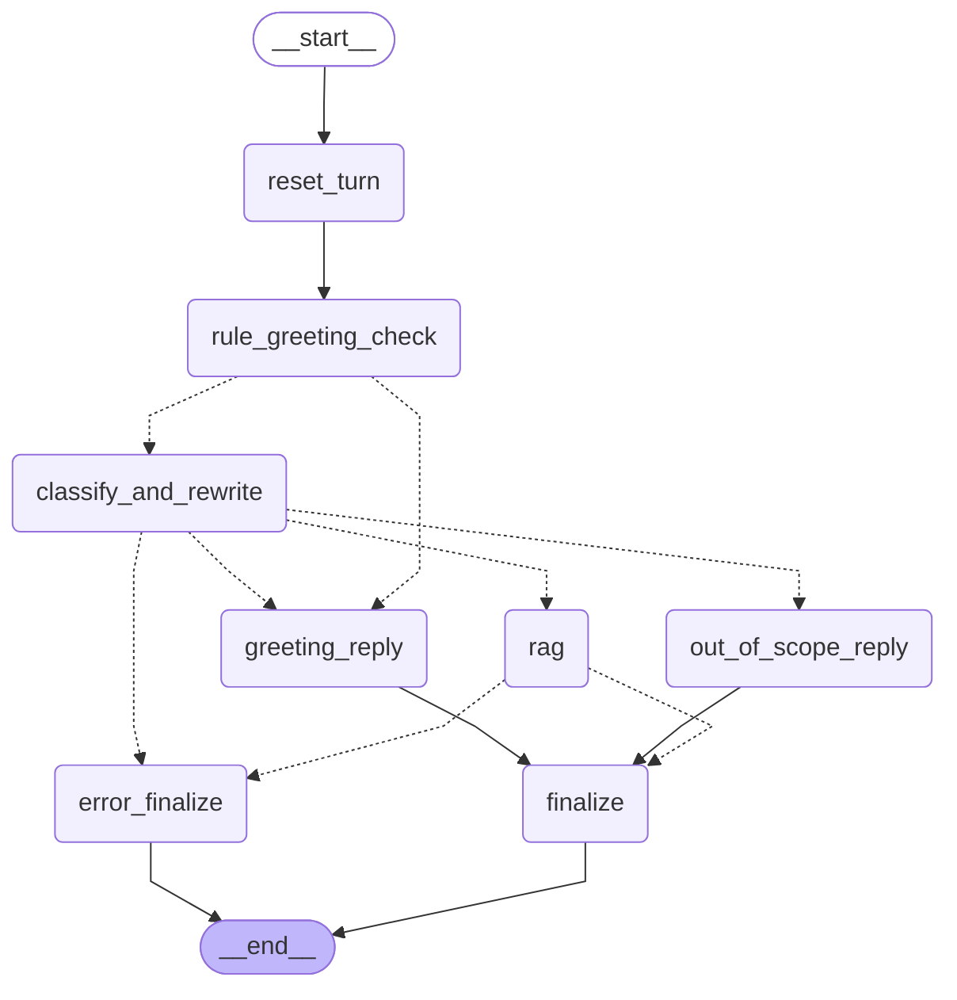
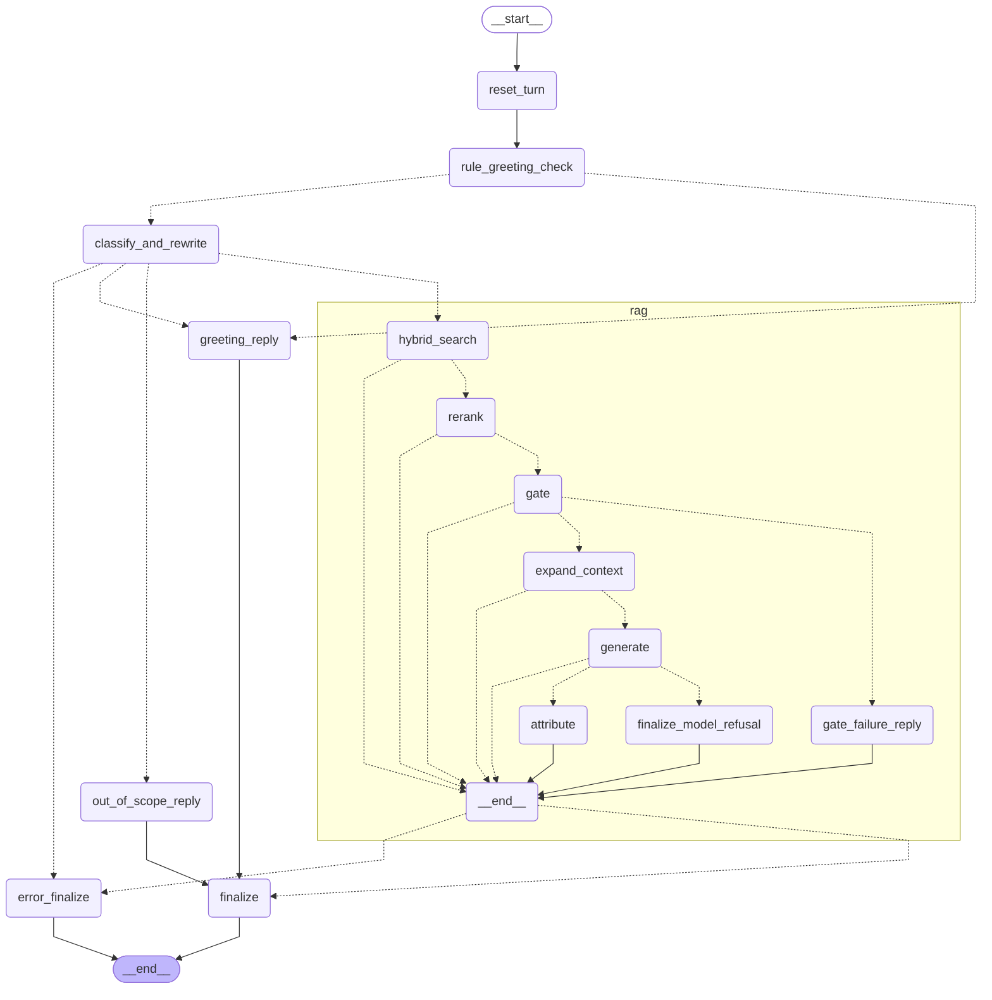

# Graph

The diagrams below are exported from the real compiled graphs; `tests/test_graph_docs.py` fails if this file goes out of date.
Regenerate with `python -m tests.test_graph_docs`.

## Main graph (conversation handling)

Every message starts at `reset_turn` (all per-message state fields reset, user message stored), then `rule_greeting_check`
(a message that is *entirely* a greeting/thanks/goodbye never reaches an LLM). Everything else goes to `classify_and_rewrite`
(LLM call #1: route + standalone question). Four ways out:

| Route | Path | LLM calls |
|---|---|---|
| Pure greeting (rule) | `reset_turn → rule_greeting_check → greeting_reply → finalize` | 0 |
| Greeting (LLM) | `… → classify_and_rewrite → greeting_reply → finalize` | 1 |
| Out of scope | `… → classify_and_rewrite → out_of_scope_reply → finalize` | 1 |
| NIST question | `… → classify_and_rewrite → rag (subgraph) → finalize` | 1 + 1 if it reaches generation |
| Any failure | `… → error_finalize` (the one error node: outcome `error`, the unanswered user message is rolled back) | |

`finalize` appends exactly one assistant message per turn (the final answer text with `[C#]` markers stripped). Sources,
related sections, retrieval and generation data are never written into `messages`.

## RAG subgraph (answering), expanded

| Scenario | Subgraph path | Outcome |
|---|---|---|
| Answered | `hybrid_search → rerank → gate → expand_context → generate → attribute` | `answered` |
| Gate failure (best rerank score below the threshold, or no candidates) | `hybrid_search → rerank → gate → gate_failure_reply` (no generation call) | `insufficient` (`gate_low_score` / `no_candidates`) |
| Model refusal (the model wrote the Case D sentence) | `… → generate → finalize_model_refusal` | `insufficient` (`model_case_d`) |
| Fixer-forced refusal | `… → generate → finalize_model_refusal` | `insufficient` (`fix_partial_answer`, `fix_no_citations`, `fix_empty_output`) |
| Any node failure | the failing node, then the subgraph exits; the main graph routes to `error_finalize` | `error` |

There are no loops and no retries anywhere: the graph is a decision tree.
